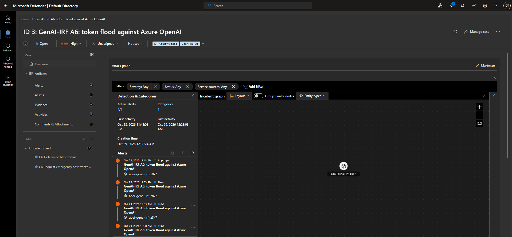
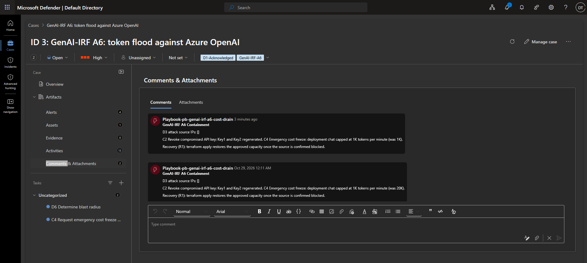
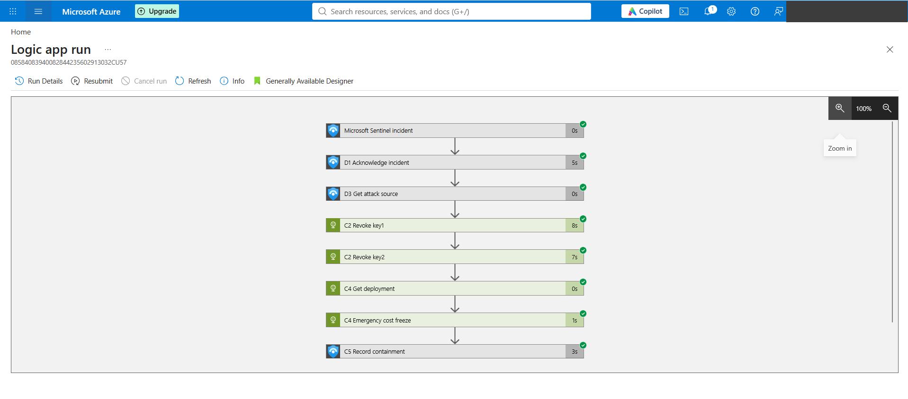

# A6: Denial of Service and Cost Drain

> A stolen API key is used to hammer an Azure OpenAI deployment with long completions, the pattern
> known as LLMjacking. A Sentinel rule spots the token spike, and a Logic Apps playbook rotates both
> keys and caps the deployment's capacity within minutes. The attacker's next call fails with 401.

**Archetype:** A6 in the GenAI-IRF framework ([overview](../README.md))
**Maps to:** OWASP LLM10 Unbounded Consumption, MITRE ATLAS AML.T0034 Cost Harvesting and AML.T0029 Denial of AI Service
**Status:** Complete

---

## Objective

Show that abuse of a leaked key is detected from usage alone, and that the A6 playbook contains it
the way the paper describes: identify the source, revoke the key, freeze spend, and leave a
record for the people who own the follow up.

## The problem (insecure default)

Azure OpenAI keys are bearer secrets. Whoever holds one can call the deployment from anywhere, and
every token is billed to the owner. A deployment sized for production traffic has plenty of
headroom for an attacker, and the first sign is often the invoice. Defender for AI does not raise
an alert for heavy but otherwise normal traffic, so a usage based detection is needed.

## How it works

| Step | Component | What happens |
|---|---|---|
| 1 | Test script | Sends up to 45 requests for 600 token completions to `chat` with key1, 0.5 s apart |
| 2 | Azure Monitor | `GeneratedTokens` for the account lands in `AzureMetrics` in the workspace |
| 3 | Sentinel rule `GenAI-IRF A6: token flood against Azure OpenAI` | Every 5 minutes, sums generated tokens over 15 minutes per account and alerts above 15,000; joins RequestResponse logs for the busiest caller IP |
| 4 | Incident grouping | Alerts for the same entities within an hour go into one incident |
| 5 | Automation rule | On incident creation, adds tasks D6 and C4 and runs `pb-genai-irf-a6-cost-drain` |
| 6 | Playbook | Runs the A6 steps below |

### Playbook steps mapped to the paper

| Logic Apps action | Paper step | What it does |
|---|---|---|
| `D1_Acknowledge_incident` | D1 Acknowledge and triage | Sets the incident to Active and High, tags it `GenAI-IRF-A6`, `D1-Acknowledged` |
| `D3_Get_attack_source` | D3 Identify attack source | Reads the IP entities from the incident |
| `C2_Revoke_key1`, `C2_Revoke_key2` | C2 Revoke compromised API key | Calls the ARM `regenerateKey` action for both keys with the playbook's managed identity |
| `C4_Get_deployment`, `C4_Emergency_cost_freeze` | C4 Emergency cost freeze | Reads the `chat` deployment and writes it back with capacity 1 (1,000 tokens per minute) |
| `C5_Record_containment` | Containment record | Comments what was done and how to recover |

Tasks added for people: D6 determine blast radius (which keys, applications and spend were
affected) and C4 request the cost freeze with Finance and raise a budget alert.

### Design decisions (the "why")

- **Metrics, not request logs.** The first version of the rule counted `RequestResponse` diagnostic
  records. Those are sampled (10 of 48 calls were logged in one test), so the count never crossed
  the threshold reliably. `AzureMetrics` `GeneratedTokens` is complete, so the rule sums that and
  only uses the logs to enrich the alert with a caller IP.
- **Rotate both keys.** The attacker may hold either key, and regenerating only one leaves the other
  working. Legitimate clients should read keys from Key Vault, or better use Entra ID, so rotation
  does not break them.
- **Cap capacity instead of blocking an IP.** The paper's C3 step blocks the attacker's address.
  Azure AI services network rules are an allow list only, so a single address cannot be denied
  without first listing every legitimate one. Capping the deployment at 1,000 tokens per minute
  limits spend from any source and is easy to undo.
- **Scoped permissions.** The playbook identity holds *Microsoft Sentinel Responder* on the resource
  group and *Cognitive Services Contributor* on the one Azure OpenAI account, enough to rotate keys
  and change capacity there and nowhere else.

## Steps & output

**1. Deploy.** `terraform apply` from the shared [`terraform`](../terraform) folder (see the
[overview](../README.md#built-as-code)). `chat` starts at capacity 20 (20,000 tokens per minute).

**2. Flood the deployment.** From the `terraform` folder:

```
.\scripts\test-a6-flood.ps1
```

The first 26 calls succeeded. Call 27 returned 401 Unauthorized and the script stopped: by then
the playbook had already rotated the key it was using.

**3. Detection.** The rule fired from 23:48 IST on 28 October 2026, and its alerts were grouped
into one High severity case, `GenAI-IRF A6: token flood against Azure OpenAI`, with the Azure
OpenAI account as the entity and tasks D6 and C4 attached (screenshot 01).

**4. Response.** The automation rule started the playbook about three minutes after the incident
was created, and every step succeeded (screenshot 03). The playbook comment on the case records
the outcome (screenshot 02):

```
D3 attack source IPs: []
C2 Revoke compromised API key: Key1 and Key2 regenerated.
C4 Emergency cost freeze: deployment chat capped at 1K tokens per minute (was 20K).
Recovery (R1): terraform apply restores the approved capacity once the source is confirmed blocked.
```

Running the playbook a second time by hand from the case, on 1 November, added a second comment
reporting the capacity was already 1K: the actions are safe to repeat.

The flood script's 27th call failed with 401 Unauthorized, and the deployment list confirmed the
cap:

```
az cognitiveservices account deployment list -g lab-genai-irf -n aoai-genai-irf-jz8x7 --query "[].{n:name,cap:sku.capacity}" -o table
N              Cap
-------------  -----
chat           1
chat-annotate  10
```

**5. Recovery (R1).** Running `terraform apply` again sets `chat` back to capacity 20. The
regenerated keys stay as they are; clients fetch the new key.

## Lessons

- **No attack source IP.** Azure OpenAI masks the last octet of `CallerIPAddress` in diagnostic logs,
  so the IP entity mapping had nothing valid to map and D3 recorded an empty list. Source
  attribution needs the application to log the client address, or `UserSecurityContext` on each
  request as in the [A1 lab](../a1-jailbreak).
- **Sampled logs are not a counter.** RequestResponse records are fine for evidence but not for
  thresholds. Use platform metrics for volume.
- **Automation works here because this rule creates the incident.** Unlike A1, the A6 incident comes
  from a Sentinel scheduled rule, so the automation rule's analytics rule condition matches and
  the playbook runs with no one involved.

## Evidence

*The portal account name is masked. No keys appear; only the fact that they were regenerated.*

| # | Shows |
|---|---|
| 01 | Defender XDR case: High severity, A6 tags, tasks D6 and C4, four rule alerts grouped |
| 02 | Playbook containment comments: the automatic run on 29 October (00:11 IST) and a manual rerun |
| 03 | Logic Apps run started by the automation rule: D1, D3, C2 both keys, C4 cost freeze, C5 record |





## SC-500 concepts demonstrated

- **Scheduled analytics rules.** KQL over `AzureMetrics` and `AzureDiagnostics`, entity mapping,
  custom details and alert grouping into incidents.
- **Automation rules.** Triggered on incident creation, adding tasks and running a playbook in order.
- **Playbooks acting on Azure resources.** A managed identity with a scoped Azure RBAC role calling
  ARM operations (`regenerateKey`, deployment update) on the resource under attack.
- **Securing Azure OpenAI access.** Why key auth is risky, and why Entra ID with managed identities
  is the stronger default.

## How I'd extend this

- Disable local auth on the account after rotation (`disableLocalAuth`), so only Entra ID callers work.
- Add an Azure budget alert and a Cost Management anomaly alert as a second signal for C4.
- Put Azure API Management in front of the model with per subscription token limits, so a leaked
  key is rate limited before Sentinel has to act.
- Send the C5 summary to the service owner in Teams.

## Cleanup

Covered by `terraform destroy` in the shared [`terraform`](../terraform) folder (see the
[overview](../README.md#cleanup)).
