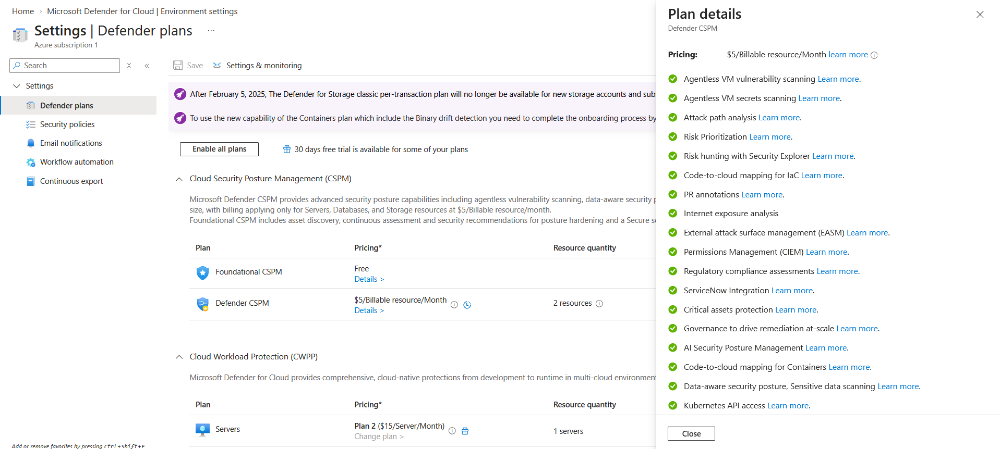
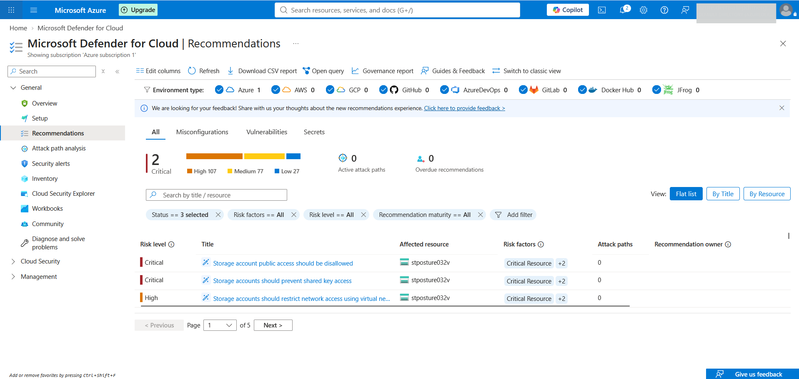
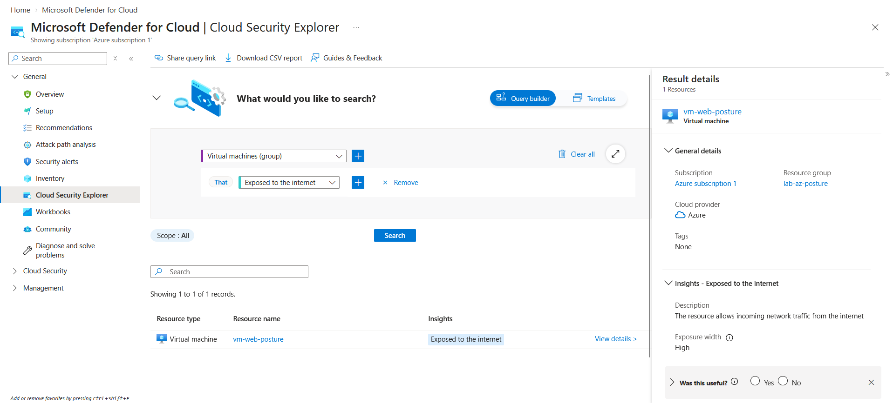
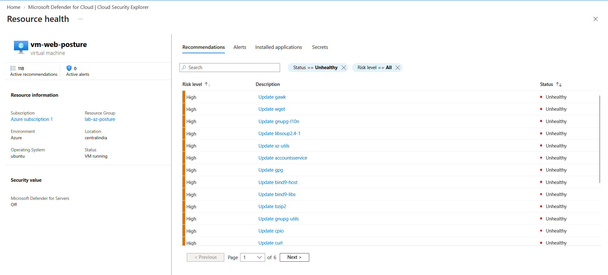
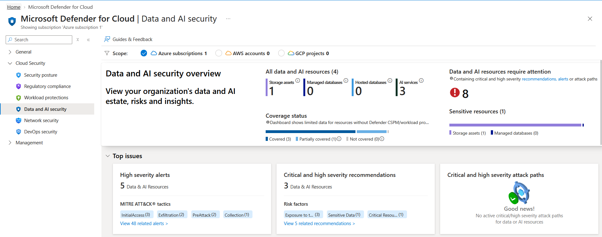
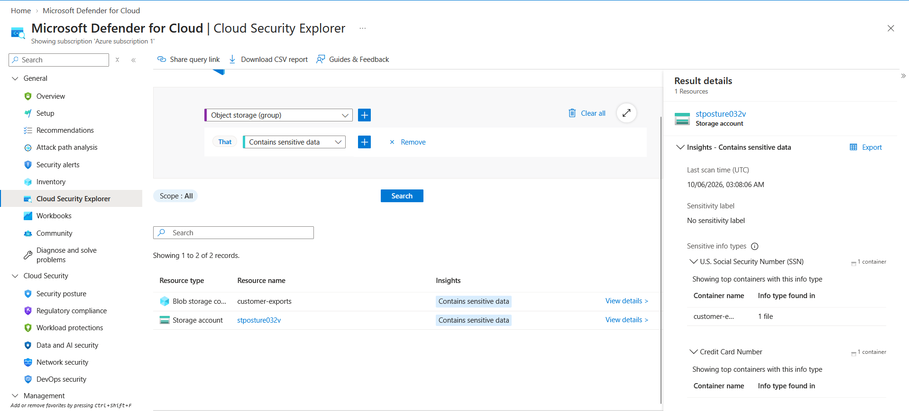
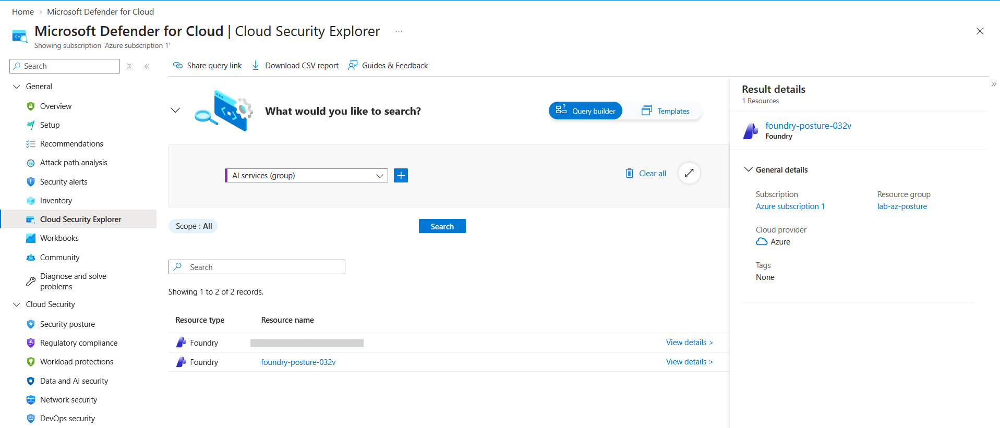
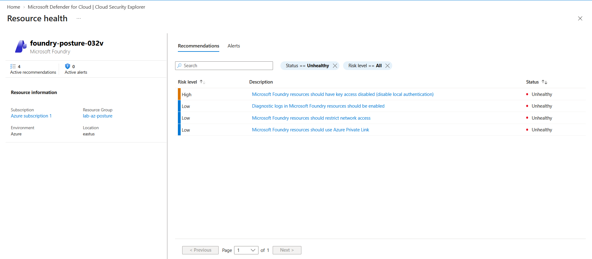
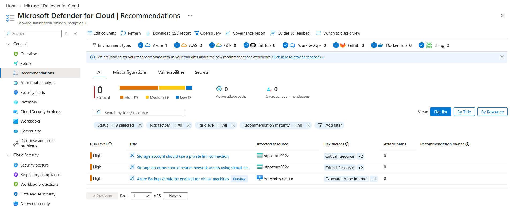

# Lab: Posture Management with Defender CSPM (CSPM, DSPM and AI-SPM)

> Built a deliberately weak environment with Terraform and let Defender CSPM find what an attacker
> would: a public container full of card numbers and SSNs, an internet exposed VM with over a hundred
> unpatched packages, and an AI model reachable with a static key. One plan, three views of risk:
> cloud configuration (CSPM), sensitive data (DSPM) and AI workloads (AI-SPM). One finding in each
> area was then fixed at its root.

**Domain:** 4 (Security Posture and Monitoring, SC-500)
**Services:** Microsoft Defender for Cloud (Defender CSPM plan), sensitive data discovery, attack path analysis, Cloud Security Explorer, AI security posture management, Azure Storage, Microsoft Foundry, Terraform
**Status:** Complete

---

## Objective

Show how Defender CSPM moves from a flat list of misconfigurations to prioritized risk. The free
Foundational CSPM tier (covered in the `defender-for-cloud` lab) reports each weak setting on its
own. The paid Defender CSPM plan adds context: which data stores actually hold sensitive data, which
resources can reach them, and which AI models and endpoints exist in the estate. The lab proves each
of those three views with a planted weakness and the finding it produced.

## The problem (insecure default)

A typical small estate drifts into exactly this shape: a storage container someone made public to
share an export, a VM opened to SSH for convenience, a managed identity given read access "for now",
and an AI endpoint called with its account key. Each item looks minor in a recommendations list.
Together they form a path from the internet to regulated data and to a paid model. Without context
about data sensitivity and identity reach, nothing tells the defender which of the hundreds of
recommendations matters first.

## Lab environment

| Item | Value |
|---|---|
| Resource group | `lab-az-posture` |
| Defender plan | Defender CSPM (`CloudPosture`, Standard) with sensitive data discovery, agentless VM scanning and the other plan extensions on |
| Storage account (DSPM target) | `stposture032v`, East US, container `customer-exports` with anonymous blob read |
| Sample data | `customers-2026-q3.csv`: 40 synthetic records with Luhn valid test card numbers and made up SSNs |
| Foundry resource (AI-SPM target) | `foundry-posture-032v` (AIServices, S0), East US, key auth on, public endpoint |
| Model deployment | `chat-dep`: `gpt-4.1-mini` (2025-04-14), GlobalStandard, capacity 1 |
| VM (attack path source) | `vm-web-posture`, Ubuntu 20.04, `Standard_B2as_v2`, Central India |
| Network | `vnet-posture` 10.50.0.0/16, subnet `snet-web` 10.50.1.0/24, NSG `nsg-web-posture` allowing SSH from Internet, static public IP |
| VM identity | System assigned, *Storage Blob Data Reader* on the storage account, *Cognitive Services OpenAI User* on the Foundry resource |

The sample data is generated, not real. The card numbers pass the Luhn check so that classifiers
treat them as card numbers, but they belong to no issuer account, and the SSNs and names are random.

## What I built

| Component | Role in the design |
|---|---|
| Defender CSPM plan | Supplies the context engine: sensitive data discovery, agentless scanning, the security graph, attack paths and the AI bill of materials |
| `stposture032v` / `customer-exports` | Publicly readable data store holding regulated data types (DSPM finding) |
| `foundry-posture-032v` + `chat-dep` | AI workload with key based auth and an open endpoint (AI-SPM findings) |
| `vm-web-posture` | Internet exposed compute on an out of support image, the entry point for attack paths |
| VM managed identity role assignments | The lateral movement edge: exposed VM to sensitive data and to the model |

### Design decisions (the "why")

- **Plant one weakness per lens.** Public sensitive data for DSPM, exposed and vulnerable compute
  for CSPM attack paths, and a key authenticated public model for AI-SPM. Each finding in the
  evidence can be traced to one line of Terraform.
- **Connect the weaknesses through identity.** Attack path analysis only flags a path when a
  reachable resource can actually act on a valuable target. The VM's managed identity holds data
  plane roles on both the storage account and the Foundry resource, which turns three separate
  misconfigurations into one exploitable chain.
- **Ubuntu 20.04 on purpose.** The image is past standard support, so agentless scanning finds
  unpatched packages. Attack paths that start from an internet exposed VM weigh its vulnerabilities.
- **The plan is not managed by Terraform.** Defender CSPM was already enabled at subscription level.
  Keeping it outside the configuration means `terraform destroy` removes the lab without silently
  downgrading the subscription's posture coverage.
- **Upload over Entra auth.** The provider uses `storage_use_azuread`, and the deploying user gets
  *Storage Blob Data Contributor* on the account, so the sample file is written without the account
  key even though key access is left on as one of the findings.
- **Split regions.** East US had no capacity for small VM sizes during the build (`B2as_v2` and
  `D2s_v5` both returned `SkuNotAvailable`), so the VM and its network moved to Central India through
  a `vm_location` variable. Defender's graph is subscription wide, so the paths still connect.

## Steps & output

Resources were applied on 5 October 2026 and left for the scanners to run. Evidence was collected
on 7 and 8 October, after the first full scan cycle.

**1. Confirm the plan and its extensions.** Defender for Cloud > Environment settings > subscription >
Defender plans. Defender CSPM is On with sensitive data discovery, agentless scanning and the other
extensions enabled (screenshot 01).

**2. Read the prioritized recommendations.** Defender for Cloud > Recommendations. The two Critical
items in the subscription are both on `stposture032v`: *Storage account public access should be
disallowed* and *Storage accounts should prevent shared key access*, each tagged with the
*Critical Resource* risk factor. The tag comes from the data scan, not from the setting itself: the
same misconfiguration on an empty account would rank lower (screenshot 02).

**3. Query the security graph.** Cloud Security Explorer, *Virtual machines* that are *Exposed to the
internet*, returns `vm-web-posture` with high exposure width (screenshot 03). The VM's resource view
shows 118 unhealthy recommendations, most of them high severity package updates found by agentless
scanning, with Defender for Servers off (screenshot 04).

**4. Find the sensitive data (DSPM).** The Data and AI security dashboard counts four data and AI
resources, one sensitive resource and eight needing attention (screenshot 05). Cloud Security
Explorer, *Object storage* that *Contains sensitive data*, returns the `customer-exports` container
and its account. The result details list the classifications from the scan on 6 October:
*U.S. Social Security Number (SSN)* and *Credit Card Number*, found in one file, with *No sensitivity
label* applied (screenshot 06).

**5. Inventory and assess the AI workload (AI-SPM).** Cloud Security Explorer, *AI services*, lists
the Foundry resources in the subscription, including `foundry-posture-032v` (screenshot 07; an
unrelated resource is masked). Its resource view carries four AI recommendations, led by the High
severity *Microsoft Foundry resources should have key access disabled (disable local
authentication)*, followed by network restriction, Private Link and diagnostic logging (screenshot 08).

**6. Fix one finding per lens.** Run from PowerShell with the Azure CLI signed in:

```
# DSPM: close anonymous access and shared key access on the sensitive store
az storage account update -n stposture032v -g lab-az-posture --allow-blob-public-access false --allow-shared-key-access false --query "{public:allowBlobPublicAccess,sharedKey:allowSharedKeyAccess}"
{
  "public": false,
  "sharedKey": false
}

# AI-SPM: Entra ID only on the Foundry resource
az resource update -g lab-az-posture -n foundry-posture-032v --resource-type Microsoft.CognitiveServices/accounts --set properties.disableLocalAuth=true --query properties.disableLocalAuth
true

# CSPM: remove the inbound SSH rule from the internet
az network nsg rule delete -g lab-az-posture --nsg-name nsg-web-posture -n allow-ssh-internet
```

The VM identity keeps working after the storage change because it reads with Entra ID
(*Storage Blob Data Reader*), not with the account key. Defender re-evaluates on its next assessment
cycle. By 12 October the subscription showed 0 Critical recommendations, down from 2: both storage
findings had cleared, and the remaining High items on the account are the network hardening steps
(private link, network restriction) left for the extension ideas below (screenshot 09).

**What did not appear.** No attack path was raised during the lab window: Attack path analysis and
the dashboard both reported zero. The graph did hold every ingredient (internet exposure, high
severity vulnerabilities, sensitive data and the identity edge). Attack paths come from a fixed set
of Microsoft scenarios and are computed on their own schedule, so a newly built estate can show the
ingredients before any path is published. Cloud Security Explorer was used to show the same chain
query by query.

## Built as code

The whole environment is defined in [`terraform/main.tf`](terraform/main.tf) (azurerm 4.x) and the
synthetic data in [`terraform/sample-data`](terraform/sample-data). The configuration passes
`terraform validate` and was applied to build the lab shown in the evidence.

Run it from the lab's `terraform` folder:

```
cd terraform
$env:ARM_SUBSCRIPTION_ID = az account show --query id -o tsv
terraform init
terraform plan -out tfplan
terraform apply tfplan
```

Prerequisites outside Terraform: the Defender CSPM plan with sensitive data discovery enabled by a
subscription Owner (some components, such as agentless scanning, only switch on when an Owner
enables the plan), and the `Microsoft.Storage`, `Microsoft.CognitiveServices`, `Microsoft.Compute`
and `Microsoft.Network` providers registered, since the provider is set not to register them.

| Lab piece | Terraform resource |
|---|---|
| Resource group | `azurerm_resource_group` |
| Storage account with public blob access allowed | `azurerm_storage_account` |
| Public container and sample CSV | `azurerm_storage_container`, `azurerm_storage_blob` |
| Upload permission for the deploying user | `azurerm_role_assignment`, `time_sleep` |
| Foundry resource and model deployment | `azurerm_cognitive_account`, `azurerm_cognitive_deployment` |
| VNet, subnet, NSG, public IP, NIC | `azurerm_virtual_network`, `azurerm_subnet`, `azurerm_network_security_group`, `azurerm_subnet_network_security_group_association`, `azurerm_public_ip`, `azurerm_network_interface` |
| VM with managed identity and SSH key | `azurerm_linux_virtual_machine`, `tls_private_key` |
| VM identity access to data and model | `azurerm_role_assignment` (x2) |
| Global name suffix | `random_string` |

State, plans and logs stay on the local machine and are excluded by
[`terraform/.gitignore`](terraform/.gitignore). The VM's private key exists only in that local
state; nobody logs in to the VM.

## Evidence

*No sensitive identifiers appear in these images (subscription ID, tenant ID, object IDs, public IP
and UPNs are masked or cropped).*

| # | Shows |
|---|---|
| 01 | Defender CSPM plan on with its extensions, including sensitive data discovery |
| 02 | Critical recommendations on the storage account, ranked by the *Critical Resource* risk factor |
| 03 | Cloud Security Explorer: the VM returned as exposed to the internet |
| 04 | Agentless scanning results on the VM: 118 recommendations with Defender for Servers off |
| 05 | Data and AI security dashboard: one sensitive resource, three AI services |
| 06 | Sensitive info types found in `customer-exports`: U.S. SSN and credit card number, no label |
| 07 | AI services inventory in Cloud Security Explorer |
| 08 | AI-SPM recommendations on the Foundry resource, key access disabled rated High |
| 09 | After remediation: Critical count down from 2 to 0; the public access and shared key findings are gone, leaving the network hardening items |











## Configuration & identifiers (redacted)

Resource names, the 10.50.x addresses and Microsoft built in role names are shown as deployed.
Subscription, tenant and object IDs and the VM's public IP are not recorded here. The sample data
file is synthetic and safe to publish.

## SC-500 concepts demonstrated

- **Foundational CSPM versus Defender CSPM.** The free tier gives secure score and recommendations;
  the paid plan adds the cloud security graph, attack path analysis, Cloud Security Explorer,
  agentless scanning, data security posture and AI security posture.
- **Data security posture management.** Sensitive data discovery samples data stores, classifies
  them with Microsoft Purview sensitive information types (credit card number, U.S. SSN) and labels
  the resource, so exposure findings carry data sensitivity.
- **Attack path analysis and the security graph.** Risk is computed across relationships: internet
  exposure, software vulnerabilities and identity permissions combine into a ranked path to a high
  value target. Paths follow predefined scenarios on their own schedule; Cloud Security Explorer
  queries the same graph on demand.
- **AI security posture management.** Defender discovers AI workloads into an AI bill of materials
  (resources, deployments, models) and assesses them, for example key based authentication and
  unrestricted network access on Azure AI resources.
- **Remediation closes the loop.** Fixing a finding at its root (disabling anonymous access, removing
  key auth, closing the NSG rule) is verified by Defender's next assessment, not by assumption.

## How I'd extend this

- Add a governance rule that assigns each high severity recommendation an owner and a due date.
- Turn on Defender for Storage malware scanning and Defender for AI services threat protection to
  pair posture findings with runtime alerts, and stream both to Sentinel.
- Import custom sensitive information types and sensitivity labels from Microsoft Purview so DSPM
  classifies organization specific data.
- Enforce the fixes with Azure Policy (deny anonymous blob access, deny local auth on AI services) so
  the same weakness cannot be reintroduced.
- Put the Foundry resource behind a private endpoint, as in the `private-endpoint-dns` lab, and
  watch the related AI-SPM recommendation and attack path disappear.

## Cleanup

From the lab's `terraform` folder (running it from the repo root does nothing):

```
terraform destroy
```

Defender CSPM stays enabled at subscription level and bills per covered resource (servers, storage
accounts and databases), so the lab's cost stops once the resources are destroyed. Turn the plan off
in Environment settings only if no other workload needs it.
