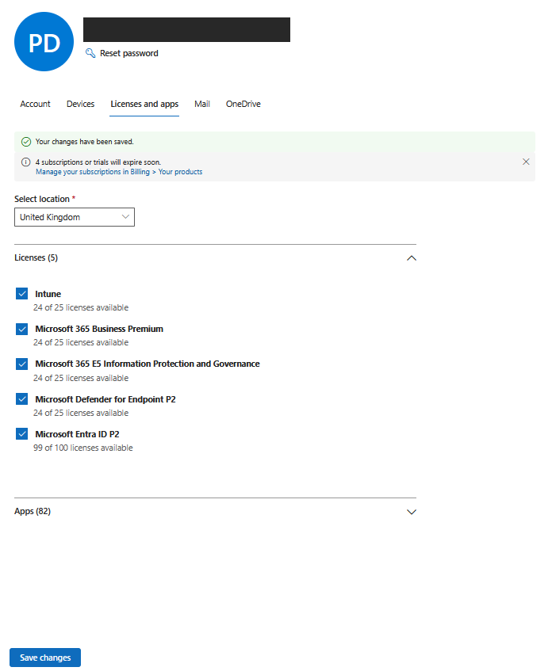
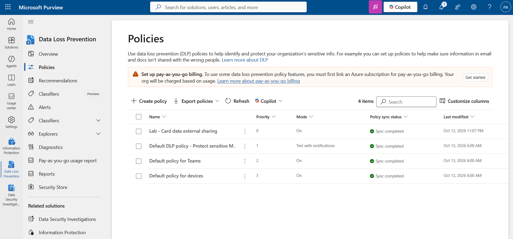
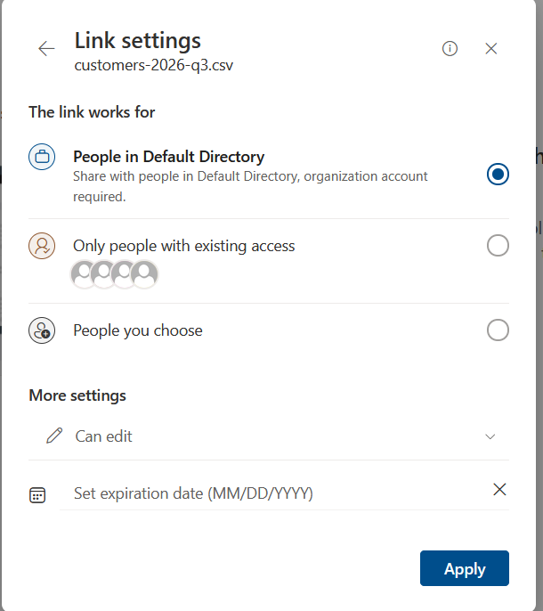
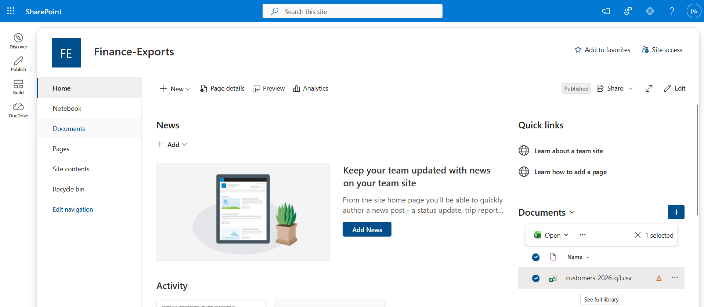
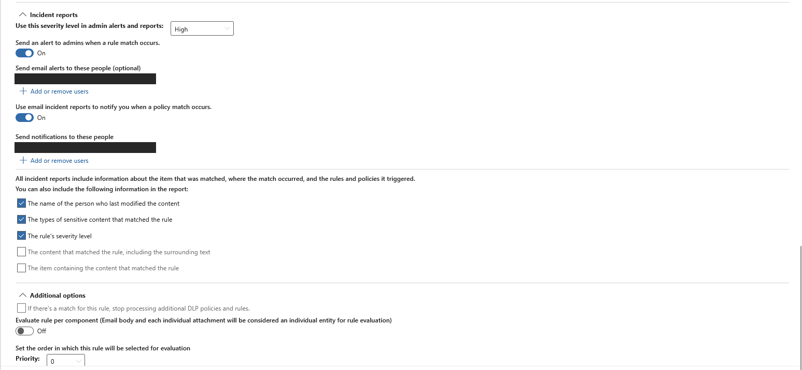

# Lab: Purview DLP for Card Data in SharePoint

> Built a Microsoft Purview data loss prevention policy that watches every SharePoint site for
> credit card numbers and blocks anonymous access to any file that contains them. A synthetic
> customer export was uploaded to a finance site, Purview classified it, and the file was flagged
> with a policy tip while the "Anyone with the link" option was not offered for it.

**Domain:** 4 (Security Posture and Monitoring, SC-500)
**Services:** Microsoft Purview Data Loss Prevention, sensitive information types, Microsoft Purview Audit, SharePoint Online, Security & Compliance PowerShell
**Status:** Complete (alert stage partial, see step 6)

---

## Objective

Show how Purview DLP turns content classification into an enforced control. The `posture-management-cspm-dspm-aispm`
lab found the same customer file sitting in a public storage container; this lab takes the Microsoft
365 side of that story. When the file lands in SharePoint, Purview should recognise the card numbers
without anyone labelling it, warn the owner in place, and stop the file from being opened through an
anonymous link.

## The problem (insecure default)

SharePoint lets site owners share files with "Anyone with the link" once the tenant allows it, and
many tenants do so that teams can send files to customers and suppliers. Nothing in that default
looks at what the file contains. A finance user who exports customer records and shares the CSV
the quick way has published card numbers to whoever ends up holding the URL, and the link keeps
working after it is forwarded.

## Lab environment

| Item | Value |
|---|---|
| Tenant | Microsoft 365 trial tenant (separate from the Azure subscription used in other labs) |
| Licences | Microsoft 365 Business Premium (trial) plus Microsoft 365 E5 Information Protection and Governance (trial add on), assigned to the admin account |
| SharePoint site | `Finance-Exports` (team site), Documents library |
| Tenant and site sharing | Raised to Anyone for the test |
| Sample data | `customers-2026-q3.csv`: 40 synthetic records with Luhn valid test card numbers and made up SSNs (same file as the posture lab, kept in [`../posture-management-cspm-dspm-aispm/terraform/sample-data`](../posture-management-cspm-dspm-aispm/terraform/sample-data)) |
| DLP policy | `Lab - Card data external sharing`, location All SharePoint sites, mode On |
| DLP rule | `Lab - Block Anyone links on card data` |
| Audit | Purview Audit recording turned on during the lab |

The tenant had no full Microsoft 365 E5 trial on offer, so the E5 Information Protection and
Governance add on supplies the Purview DLP features on top of Business Premium.

## What I built

| Component | Role in the design |
|---|---|
| DLP policy scoped to all SharePoint sites | Brings every site under the same control, including sites created after the policy |
| Rule condition: Credit Card Number, 1 or more | Uses the built in sensitive information type (pattern plus Luhn check plus keywords), so no custom classifier is needed |
| Rule action: block access for anonymous users | Leaves internal collaboration on the file intact and removes only the anonymous link audience |
| User notification to the owner | Shows the policy tip on the file so the owner knows why sharing is restricted |
| Incident reports: High severity, alert and email to the admin | Feeds the DLP alerts queue and the admin mailbox |

### Design decisions (the "why")

- **Block only anonymous access.** `BlockAccessScope PerAnonymousUser` is the narrowest block that
  closes the real exposure. Blocking everyone outside the organisation or everyone except the owner
  would also break legitimate guest sharing, and users route around controls that get in their way.
- **Built in classifier over labels.** The file has no sensitivity label, which is the realistic case
  for an ad hoc export. Matching on content means the control works even when nobody classified the
  file by hand.
- **Policy created with PowerShell, verified in the portal.** [`scripts/01-dlp-policy.ps1`](scripts/01-dlp-policy.ps1)
  makes the build repeatable and reviewable. The portal was then used to confirm sync status, the
  rule's incident report settings and the user facing result.
- **Mode On straight away.** In production this policy would run in simulation first to measure
  false positives. In a lab with one synthetic file, simulation only adds a delay.
- **Severity High on the rule.** Card data shared outside the organisation is a reportable event in
  most compliance regimes, so the alert should sort to the top of the queue.

## Steps & output

**1. Licence the admin account.** Business Premium and the E5 Information Protection and Governance
add on were started as trials and assigned to the admin user in the Microsoft 365 admin center
(screenshot 01).

**2. Allow Anyone links.** In the SharePoint admin center, external sharing was raised to Anyone at
tenant level and on the `Finance-Exports` site, recreating the risky default the policy is meant to
catch.

**3. Create the DLP policy.** From Windows PowerShell with the `ExchangeOnlineManagement` module:

```
.\scripts\01-dlp-policy.ps1 -AlertTo <admin mailbox>
```

The script connects with `Connect-IPPSSession`, creates the policy for all SharePoint locations and
adds the rule:

```
New-DlpComplianceRule -Name "Lab - Block Anyone links on card data" `
    -Policy "Lab - Card data external sharing" `
    -ContentContainsSensitiveInformation @{Name = "Credit Card Number"; minCount = "1"} `
    -BlockAccess $true `
    -BlockAccessScope PerAnonymousUser `
    -NotifyUser Owner `
    -GenerateAlert $AlertTo `
    -GenerateIncidentReport $AlertTo `
    -ReportSeverityLevel High
```

Purview > Data loss prevention > Policies then shows the policy at priority 0, mode On, with
*Sync completed* (screenshot 02). Distribution to SharePoint can take an hour or more after creation.

**4. Turn on audit.** Purview > Audit showed the *Start recording user and admin activity* banner,
meaning unified audit logging was off in the new tenant. Recording was switched on from the banner.
DLP alerts and activity explorer both depend on these audit events.

**5. Upload the file and try to share it.** `customers-2026-q3.csv` was uploaded to the Documents
library of `Finance-Exports`. In Share > Link settings, the only audiences offered were people in
the organisation, people with existing access and specific people. *Anyone with the link* was not
available for this file (screenshot 03).

Once SharePoint had indexed the file, the library showed the DLP policy tip icon next to it
(screenshot 04). The tip confirms Purview classified the CSV as containing credit card numbers and
matched the lab rule. The file was never reachable anonymously, which is the outcome the policy
exists to guarantee.

**6. Check the alert.** The rule's incident report settings were confirmed in the portal: severity
High, *Send an alert to admins when a rule match occurs* On, and email incident reports On, both
addressed to the admin mailbox (screenshot 05). No alert had appeared in Data loss prevention >
Alerts (Standard view) when evidence collection stopped.

The most likely cause is ordering. The file was uploaded on the same evening audit recording was
switched on. Audit can take up to an hour to start capturing events after it is enabled, and DLP
alerts are generated from those events. The match therefore produced the policy tip but no alert.
A second upload under a new file name, after audit is fully active, is the clean way to produce one.

## Evidence

*No sensitive identifiers appear in these images (the admin display name and UPNs are masked).*

| # | Shows |
|---|---|
| 01 | Business Premium and E5 Information Protection and Governance trials assigned to the admin |
| 02 | DLP policy list: `Lab - Card data external sharing` at priority 0, mode On, sync completed |
| 03 | Share link settings for the CSV: no *Anyone with the link* audience offered |
| 04 | `customers-2026-q3.csv` in `Finance-Exports` with the DLP policy tip icon |
| 05 | Rule incident report settings: severity High, admin alert and email report on |







## Configuration & identifiers (redacted)

The policy, rule, site and file names are shown as created. The tenant domain, admin UPN and
display name are not recorded here; the script takes the alert mailbox as a parameter instead of
storing it. The sample data file is synthetic and safe to publish.

## SC-500 concepts demonstrated

- **Sensitive information types.** The built in Credit Card Number type combines a pattern, a Luhn
  checksum and supporting keywords with a confidence level, so classification works on content
  rather than file names or labels.
- **DLP policy structure.** A policy sets the locations (here all SharePoint sites) and the mode; its
  rules hold the conditions, actions, user notifications and incident reports. Rules are evaluated
  in priority order.
- **Scoped blocking.** `BlockAccessScope` decides who loses access when a rule matches: anonymous
  users only, everyone outside the organisation, or everyone except the owner and last modifier.
- **Policy tips.** User notifications surface the match where the user works, which explains the
  restriction and reduces help desk calls.
- **Alerts depend on audit.** DLP alerts, activity explorer and audit search all read the unified
  audit log, so audit must be recording before the events that should raise alerts.
- **Pairing with DSPM.** The posture lab found the same data type in Azure Storage through Defender
  CSPM sensitive data discovery, which uses the same Purview classifiers. Together the two labs show
  one data type governed on both the Azure and Microsoft 365 sides.

## How I'd extend this

- Re-upload the file once audit is active, then follow the alert into the Defender portal, where DLP
  alerts are correlated into incidents, and query the match with `CloudAppEvents` in advanced hunting.
- Add an auto labelling policy that applies a *Confidential Customer Data* sensitivity label to the
  same content, and make the DLP rule key on the label as well as the content.
- Extend the policy to OneDrive, Exchange and Teams, and add endpoint DLP to stop the CSV being copied
  to USB or uploaded to personal cloud storage.
- Use DSPM for AI to check whether Microsoft 365 Copilot or third party AI apps can surface the file,
  and pair it with the GenAI incident response playbook lab for the response side.
- Hand the resulting DLP alert to Security Copilot for an embedded summary, as planned for the
  separate Security Copilot lab.

## Cleanup

In Security & Compliance PowerShell (`Connect-IPPSSession`):

```
Remove-DlpComplianceRule -Identity "Lab - Block Anyone links on card data" -Confirm:$false
Remove-DlpCompliancePolicy -Identity "Lab - Card data external sharing" -Confirm:$false
```

Then in the SharePoint admin center, delete the `Finance-Exports` site (and empty it from Deleted
sites) and lower external sharing back to *New and existing guests* or stricter. The licences are
trials and expire on their own; there is no Azure cost for this lab.
